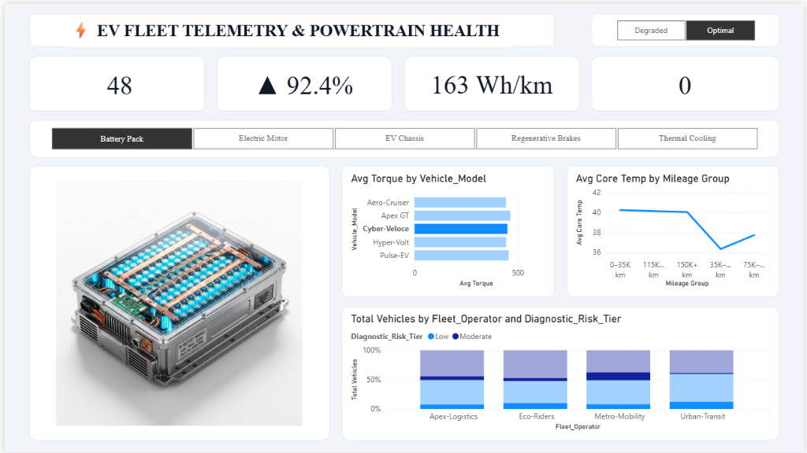
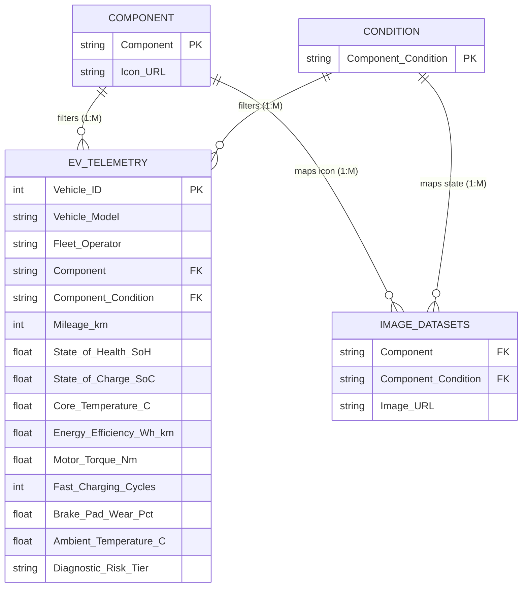

# ⚡ Electric Vehicle (EV) Telemetry & Powertrain Health 3D Analysis Dashboard

<div align="center">

[-F2C811?style=for-the-badge&logo=powerbi&logoColor=black)](https://powerbi.microsoft.com/)
[](https://learn.microsoft.com/en-us/dax/)
[](#-data-architecture--relational-model)
[](#-dataset-schema--data-dictionary)
[](LICENSE)

<br/>

**An executive-grade Fleet Telemetry & Predictive Maintenance Business Intelligence Dashboard developed in Microsoft Power BI Desktop.**  
*Analyzing high-voltage battery degradation, thermal overload, regenerative braking wear, and motor torque profiles across 2,500 commercial electric vehicles with dynamic 3D digital twin visualization.*

<br/>

[](dashboard_preview.png)

<br/>

[Executive Summary](#-executive-summary) • [Key Dashboard Features](#-key-dashboard-features) • [Interactive 3D Visuals](#-interactive-3d-digital-twins) • [Data Architecture](#-data-architecture--relational-model) • [DAX Formulas](#-dax-formulas--business-logic) • [Setup Guide](#-setup--exploration-guide)

---

</div>

## 📌 Executive Summary

As commercial and passenger electric vehicle fleets scale globally, managing battery lifecycle health, thermal safety, and drivetrain degradation is paramount to avoiding catastrophic field failures and optimizing total cost of ownership (TCO).

This dashboard provides fleet directors, reliability engineers, and automotive data analysts with a centralized telemetry intelligence center. Synthesizing sensor diagnostics from **2,500 active fleet vehicles**, the system evaluates:
- **High-Voltage Battery State of Health (SoH %)** and fast-charging degradation curves.
- **Energy Efficiency Consumption Rates (Wh/km)** against environmental operating conditions.
- **Subsystem Thermal Profiles (°C)** across vehicle mileage accumulation bands.
- **Motor Peak Output Torque (Nm)** distribution across high-performance and utility vehicle platforms.
- **Diagnostic Risk Classification (Low, Moderate, Critical)** across major logistics fleet operators.

---

## 🚀 Key Dashboard Features

1. **Dynamic 3D Component Digital Twins:**
   - Real-time dimensional image binding dynamically switches high-resolution 3D engineering renders of core vehicle subsystems.
   - Seamlessly toggle between **Optimal** (healthy / in-spec) and **Degraded** (thermal overload / mechanical wear) operating states with **100% matched camera perspective and framing**.
   - Clean solid white background (`#FFFFFF`) designed to float seamlessly inside the report visual card.

2. **Executive Metric Cards (Top KPI Ribbon):**
   - **Fleet Vehicle Cohort Count**: Real-time count of active units matching slicer filters.
   - **vs. Fleet Avg SoH %**: Dynamic directional variance tracking (`▲` outperforming / `▼` lagging) compared to fleet-wide baseline.
   - **Fleet Energy Efficiency**: Live consumption rate (`Wh/km`) calibrated to fit cleanly inside visual boundaries without truncation.
   - **Critical Diagnostic Alerts**: Instant identification of vehicles flagged for immediate depot service.

3. **Multi-Subsystem Telemetry Analysis:**
   - **Horizontal Component Selector**: Dedicated ribbon to switch focus between Battery Pack, Electric Motor, EV Chassis, Regenerative Brakes, and Thermal Cooling.
   - **Average Torque by Vehicle Model**: Comparative horizontal bar chart highlighting top-performing platforms (e.g., *Cyber-Veloce*, *Apex GT*).
   - **Average Core Temperature by Mileage Group**: Multi-stage lifecycle trend line identifying thermal spikes in high-mileage brackets.
   - **Risk Tier Distribution by Fleet Operator**: 100% stacked column chart breaking down maintenance risk profiles across commercial fleet accounts (*Apex-Logistics*, *Eco-Riders*, *Metro-Mobility*, *Urban-Transit*).

---

## 🏎️ Interactive 3D Digital Twins

The dashboard binds dimensional selections in Power BI to high-fidelity 3D powertrain subsystem models:

| Component | Optimal State (Healthy / In-Spec) | Degraded State (Thermal Runaway / Mechanical Wear) |
| :--- | :--- | :--- |
| **Battery Pack** | High-voltage Li-ion pack with pristine cylindrical cells and cool cyan LEDs | Thermal runaway cell swelling, burnt busbars, scorched module casing |
| **EV Chassis** | Carbon-fiber & titanium skateboard chassis frame with active telemetry lines | Central battery bay thermal overload glow, structural stress points |
| **Electric Motor** | Permanent-magnet drive unit with pristine copper windings and inverter | Stator core overheating discoloration, thermal arc glow, coil overload |
| **Regenerative Brakes** | Carbon-ceramic slotted rotor with high-performance cyan multi-piston caliper | Friction-induced cherry-red thermal glow, rotor disc glazing, pad fade |
| **Thermal Cooling** | Liquid chiller unit with active fluid flow and clean aluminum radiator fins | Radiator core heat map overload, boiling coolant fluid channels |

> **Design Precision:** Both Optimal and Degraded states for every subsystem share identical 3D camera angles and bounding coordinates, ensuring smooth, non-disruptive visual transitions when toggling operational health states.

---

## 🏗️ Data Architecture & Relational Model

The analytical model follows a performant **Star Schema** with bidirectional cross-filtering and real-time slice-and-dice telemetry exploration.



### 🔗 Relationship Cardinality
- `component[Component]` **1** ─── **\*** `ev_telemetry_dataset[Component]`
- `component[Component]` **1** ─── **\*** `'Image Datasets'[Component]`
- `condition[Component_Condition]` **1** ─── **\*** `ev_telemetry_dataset[Component_Condition]`
- `condition[Component_Condition]` **1** ─── **\*** `'Image Datasets'[Component_Condition]`

---

## 📊 Dataset Schema & Data Dictionary

The primary dataset (`ev_telemetry_dataset.csv`) tracks **2,500 active fleet vehicles** across 15 engineering and operating parameters:

| Column | Data Type | Description | Engineering Range / Domain |
| :--- | :--- | :--- | :--- |
| `Vehicle_ID` | Integer | Unique identifier for each fleet unit | `1` to `2500` |
| `Vehicle_Model` | String | Commercial EV vehicle platform model | `Apex GT`, `Cyber-Veloce`, `Pulse-EV`, `Aero-Cruiser`, `Hyper-Volt` |
| `Fleet_Operator` | String | Fleet logistics management operator | `Metro-Mobility`, `Apex-Logistics`, `Eco-Riders`, `Urban-Transit` |
| `Component` | String | Monitored powertrain subsystem | `Battery Pack`, `Electric Motor`, `EV Chassis`, `Regenerative Brakes`, `Thermal Cooling` |
| `Component_Condition`| String | Real-time diagnostic condition status | `Optimal`, `Degraded` |
| `Mileage_km` | Integer | Total accumulated vehicle odometer distance | `5,000` to `185,000` km |
| `State_of_Health_SoH`| Decimal | High-voltage battery pack retention health % | `66.0%` to `100.0%` |
| `State_of_Charge_SoC`| Decimal | Real-time battery charge level % | `12.0%` to `98.0%` |
| `Core_Temperature_C` | Decimal | Subsystem operational core temperature (°C) | `22.0°C` to `96.5°C` |
| `Energy_Efficiency`  | Decimal | Energy consumption rate (Watt-hours per km) | `135.0` to `275.0` Wh/km |
| `Motor_Torque_Nm`    | Decimal | Peak motor output torque (Newton-meters) | `220.0` to `720.0` Nm |
| `Fast_Charging_Cycles`| Integer | DC fast-charging events count | `12` to `890` sessions |
| `Brake_Pad_Wear_Pct` | Decimal | Regenerative friction brake pad consumption % | `4.5%` to `95.0%` |
| `Ambient_Temperature_C`| Decimal| External operating environment temperature | `8.0°C` to `42.0°C` |
| `Diagnostic_Risk_Tier`| String | Predictive maintenance priority classification | `Low`, `Moderate`, `Critical` |

---

## 🧮 DAX Formulas & Business Logic

### 1. Dynamic Battery SoH Variance Indicator
```dax
vs Avg SoH = 
VAR _CurrentSoH = AVERAGE(ev_telemetry_dataset[State_of_Health_SoH])
VAR _OverallSoH = CALCULATE(AVERAGE(ev_telemetry_dataset[State_of_Health_SoH]), ALL(ev_telemetry_dataset))
VAR _Diff = _CurrentSoH - _OverallSoH

RETURN
SWITCH(
    TRUE(),
    _Diff > 0, UNICHAR(9650) & " " & FORMAT(_CurrentSoH, "0.0") & "%",
    _Diff < 0, UNICHAR(9660) & " " & FORMAT(_CurrentSoH, "0.0") & "%",
    FORMAT(_CurrentSoH, "0.0") & "%"
)
```

### 2. Fleet Energy Consumption Efficiency
```dax
Avg Efficiency = 
FORMAT(AVERAGE(ev_telemetry_dataset[Energy_Efficiency_Wh_km]), "0") & " Wh/km"
```

### 3. Active Critical Maintenance Alerts
```dax
Critical Alerts = 
COALESCE(
    CALCULATE(COUNTROWS(ev_telemetry_dataset), ev_telemetry_dataset[Diagnostic_Risk_Tier] = "Critical"),
    0
)
```

### 4. Dynamic 3D Component Image Selector
```dax
Selected Component Image = 
CALCULATE(
    SELECTEDVALUE('Image Datasets'[Image URL]),
    TREATAS(VALUES(component[Component]), 'Image Datasets'[Component]),
    TREATAS(VALUES(condition[Component_Condition]), 'Image Datasets'[Component_Condition])
)
```

### 5. Vehicle Mileage Lifecycle Cohort (Calculated Column)
```dax
Mileage Group = 
SWITCH(
    TRUE(),
    ev_telemetry_dataset[Mileage_km] <= 35000, "0–35K km",
    ev_telemetry_dataset[Mileage_km] <= 75000, "35K–75K km",
    ev_telemetry_dataset[Mileage_km] <= 115000, "75K–115K km",
    ev_telemetry_dataset[Mileage_km] <= 150000, "115K–150K km",
    "150K+ km"
)
```

---

## 📁 Repository Directory Structure

```plaintext
EV Health and Telemetry Analysis Dashboard/
│
├── .gitignore                                 # Git exclusions for Power BI & Windows cache files
├── Background Viz.png                         # High-resolution automotive telemetry UI container
├── component.csv                              # Component dimension with cloud icon URLs
├── condition.csv                              # Operational state dimension (Optimal, Degraded)
├── dashboard_preview.png                      # High-res screenshot of the completed dashboard
├── ev_telemetry_dataset.csv                   # Primary telemetry dataset (2,500 fleet vehicles)
├── Image Datasets.csv                         # 3D image path repository (10 visual twin states)
├── LICENSE                                    # MIT Open-Source License
├── Measures and Columns Formula.txt          # Complete DAX formulas reference guide
├── README.md                                  # Executive documentation & technical guide
│
├── EV Health and Telemetry Analysis.pbip      # Power BI Project root (native developer format)
├── EV Health and Telemetry Analysis.Report/   # Report metadata (visuals, layouts, styling)
│   ├── definition.pbir                        # Report definition link
│   └── report.json                            # Visual container definitions and bindings
├── EV Health and Telemetry Analysis.SemanticModel/ # Semantic data model (TMDL/BIM)
│   ├── definition.pbism                       # Semantic model definition link
│   └── model.bim                              # Data tables, relationships, DAX measures
│
└── images/                                    # 3D High-Resolution Component Twin Renders
    ├── battery_optimal.jpg                    # High-voltage pristine battery pack
    ├── battery_degraded.jpg                   # Thermal runaway damaged battery pack
    ├── chassis_optimal.jpg                    # Pristine titanium skateboard chassis
    ├── chassis_degraded.jpg                   # Battery bay thermal overload chassis
    ├── motor_optimal.jpg                      # Pristine permanent magnet EV motor
    ├── motor_degraded.jpg                     # Overheated stator thermal damaged motor
    ├── brakes_optimal.jpg                     # High-performance carbon-ceramic brake
    ├── brakes_degraded.jpg                    # Friction-overheated glowing brake disc
    ├── cooling_optimal.jpg                    # Active fluid flow thermal chiller unit
    └── cooling_degraded.jpg                   # Boiling thermal overload cooling unit
```

---

## 🚀 Setup & Exploration Guide

### Quick Start with Power BI Desktop
1. Clone this repository:
   ```bash
   git clone https://github.com/aakash1552005/smoking-health-risk-analysis-dashboard.git
   ```
2. Double-click **`EV Health and Telemetry Analysis.pbip`** to open the project directly in **Power BI Desktop** (September 2023 release or newer).
3. The dataset, relationships, measures, and visual containers load automatically with zero manual setup.
4. Interact with the **Component ribbon** and **Optimal / Degraded toggle** to explore dynamic 3D telemetry visualization.

---

## 👤 Author

**Aakash S. S.**  
*Automotive Telemetry Analytics & Power BI Data Intelligence*  
- GitHub: [@aakash1552005](https://github.com/aakash1552005)

---

<div align="center">
  <sub>Built with Microsoft Power BI Desktop, DAX, and 3D Digital Twin Engineering Renders. Released under the MIT License.</sub>
</div>
