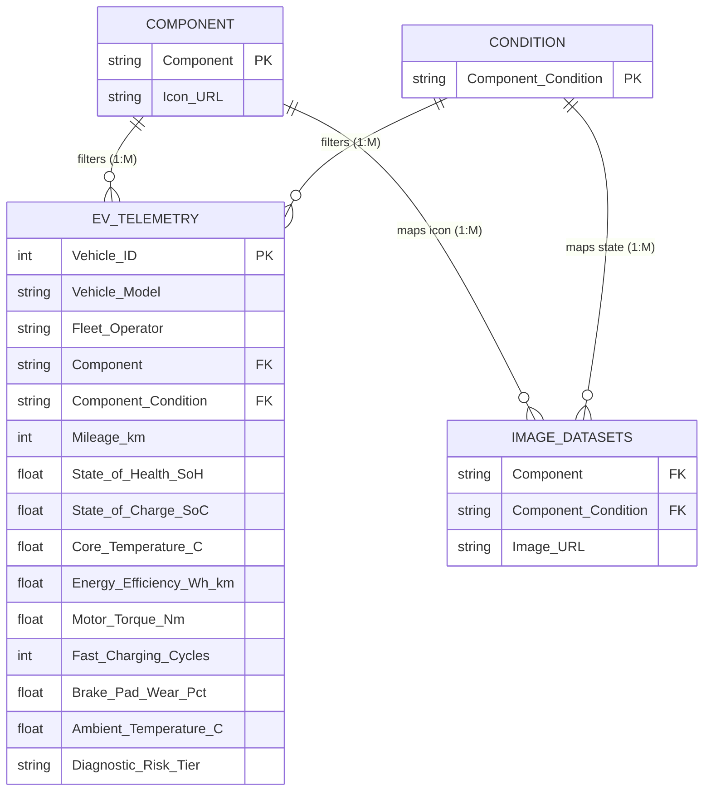

# ⚡ Electric Vehicle (EV) Telemetry & Battery Health 3D Analysis Dashboard

<div align="center">

[](https://powerbi.microsoft.com/)
[](https://learn.microsoft.com/en-us/dax/)
[](https://learn.microsoft.com/en-us/power-query/)
[](#-dataset-schema--data-dictionary)
[](LICENSE)

<br/>

**An executive-grade Fleet Telemetry & Predictive Maintenance Business Intelligence Dashboard developed in Microsoft Power BI Desktop.**  
*Analyzing high-voltage battery degradation, thermal stress, regenerative braking wear, and motor torque profiles across 2,500 electric vehicle fleet units with dynamic 3D component visualization.*

<br/>


<br/>

[Executive Summary](#-executive-summary) • [3D Visual Features](#-interactive-3d-component-visualization) • [Data Architecture](#-data-architecture--relational-model) • [DAX Formulas](#-dax-formulas--business-logic) • [Setup Guide](#-setup--exploration-guide)

---

</div>

## 📌 Executive Summary

As commercial and passenger electric vehicle fleets scale globally, managing battery lifecycle health, thermal safety, and drivetrain degradation is paramount to avoiding catastrophic field failures and optimizing total cost of ownership (TCO).

This dashboard provides fleet operators, reliability engineers, and automotive data scientists with a centralized command center. Synthesizing real-time telemetry from **2,500 active fleet vehicles**, the solution evaluates high-voltage **Battery State of Health (SoH %)**, **Fast-Charging Stress Cycles**, **Core Operating Temperatures**, and **Regenerative Braking Wear** across five core powertrain subsystems.

---

## 🏎️ Interactive 3D Component Visualization

The dashboard implements dynamic image URL binding connecting dimensional slicers to high-resolution 3D engineering renders of core vehicle subsystems across **Optimal** and **Degraded** operating states:

| Component | Optimal State (Healthy / In-Spec) | Degraded State (Thermal Runaway / Mechanical Wear) |
| :--- | :--- | :--- |
| **EV Chassis** | Carbon-fiber & titanium skateboard chassis frame with active telemetry lines | Structural fatigue fractures, warped cross-members, overheated hubs |
| **Battery Pack** | High-voltage Li-ion pack with pristine cylindrical cells and cool cyan LEDs | Thermal runaway cell swelling, burnt busbars, scorched module casing |
| **Electric Motor** | Permanent-magnet drive unit with pristine copper windings and inverter | Stator overheating discoloration, melted insulation, friction burnout |
| **Regenerative Brakes** | Carbon-ceramic slotted rotor with high-performance cyan multi-piston caliper | Thermal stress cracks, heat-warped rotor disc, grooved glazed surfaces |
| **Thermal Cooling** | Liquid chiller unit with active fluid flow and clean aluminum radiator fins | Ruptured hoses, boiling coolant leakage, corroded radiator fins |

---

## 🏗️ Data Architecture & Relational Model

The analytical model follows a performant Star Schema optimized for bidirectional cross-filtering and real-time slice-and-dice telemetry exploration.



### 🔗 Relationship Cardinality
- `component[Component]` **1** ─── **\*** `ev_telemetry_dataset[Component]`
- `component[Component]` **1** ─── **\*** `Image Datasets[Component]`
- `condition[Component_Condition]` **1** ─── **\*** `ev_telemetry_dataset[Component_Condition]`
- `condition[Component_Condition]` **1** ─── **\*** `Image Datasets[Component_Condition]`

---

## 📊 Dataset Schema & Data Dictionary

The primary dataset (`ev_telemetry_dataset.csv`) tracks **2,500 active fleet vehicles** across 15 engineering and operating parameters:

| Column | Data Type | Description | Engineering Range / Domain |
| :--- | :--- | :--- | :--- |
| `Vehicle_ID` | Integer | Unique identifier for each fleet unit | `1` to `2500` |
| `Vehicle_Model` | String | Commercial EV vehicle platform model | `Apex GT`, `Cyber-Veloce`, `Pulse-EV`, `Aero-Cruiser`, `Hyper-Volt` |
| `Fleet_Operator` | String | Fleet logistics management operator | `Metro-Mobility`, `Apex-Logistics`, `Eco-Riders`, `Urban-Transit` |
| `Component` | String | Monitored powertrain subsystem | `EV Chassis`, `Battery Pack`, `Electric Motor`, `Regenerative Brakes`, `Thermal Cooling` |
| `Component_Condition`| String | Real-time diagnostic condition status | `Optimal`, `Degraded` |
| `Mileage_km` | Integer | Total accumulated vehicle odometer distance | `5,000` to `185,000` km |
| `State_of_Health_SoH`| Decimal | High-voltage battery pack retention health % | `66.0%` to `100.0%` |
| `State_of_Charge_SoC`| Decimal | Real-time battery charge level % | `12.0%` to `98.0%` |
| `Core_Temperature_C` | Decimal | Subsystem operational core temperature (°C) | `22.0°C` to `96.5°C` |
| `Energy_Efficiency`  | Decimal | Energy consumption rate (Watt-hours per km) | `135.0` to `275.0` Wh/km |
| `Motor_Torque_Nm`    | Decimal | Peak motor output torque (Newton-meters) | `220.0` to `720.0` Nm |
| `Fast_Charging_Cycles`| Integer | DC fast-charging events count | `12` to `890` sessions |
| `Brake_Pad_Wear_Pct` | Decimal | Regenerative friction brake pad consumption % | `4.5%` to `95.0%` |
| `Ambient_Temperature_C`| Decimal| External operating environment temperature | `8.0°C` to `42.0°C` |
| `Diagnostic_Risk_Tier`| String | Predictive maintenance priority classification | `Low`, `Moderate`, `Critical` |

---

## 🧮 DAX Formulas & Business Logic

### 1. Calculated Column: Mileage Lifecycle Cohort
```dax
Mileage Group = 
SWITCH(
    TRUE(),
    ev_telemetry_dataset[Mileage_km] <= 35000, "0–35K km",
    ev_telemetry_dataset[Mileage_km] <= 75000, "35K–75K km",
    ev_telemetry_dataset[Mileage_km] <= 115000, "75K–115K km",
    ev_telemetry_dataset[Mileage_km] <= 150000, "115K–150K km",
    "150K+ km"
)
```

### 2. Measure: Dynamic Battery SoH Variance Indicator
```dax
vs Avg SoH = 
VAR _CurrentSoH = AVERAGE(ev_telemetry_dataset[State_of_Health_SoH])
VAR _OverallSoH = CALCULATE(AVERAGE(ev_telemetry_dataset[State_of_Health_SoH]), ALL(ev_telemetry_dataset))
VAR _Diff = _CurrentSoH - _OverallSoH

RETURN
SWITCH(
    TRUE(),
    _Diff > 0, UNICHAR(9650) & " " & FORMAT(_CurrentSoH, "0.0") & "%",
    _Diff < 0, UNICHAR(9660) & " " & FORMAT(_CurrentSoH, "0.0") & "%",
    FORMAT(_CurrentSoH, "0.0") & "%"
)
```

### 3. Measure: Dynamic Mileage Baseline Indicator
```dax
vs Avg Mileage = 
VAR _CurrentMileage = AVERAGE(ev_telemetry_dataset[Mileage_km])
VAR _OverallMileage = CALCULATE(AVERAGE(ev_telemetry_dataset[Mileage_km]), ALL(ev_telemetry_dataset))
VAR _Diff = _CurrentMileage - _OverallMileage

RETURN
SWITCH(
    TRUE(),
    _Diff > 0, UNICHAR(9650) & " " & FORMAT(_CurrentMileage / 1000, "0.0") & "K",
    _Diff < 0, UNICHAR(9660) & " " & FORMAT(_CurrentMileage / 1000, "0.0") & "K",
    FORMAT(_CurrentMileage / 1000, "0.0") & "K"
)
```

### 4. Measure: Dynamic 3D Component Image Selector
```dax
Selected Component Image = 
CALCULATE(
    SELECTEDVALUE('Image Datasets'[Image URL]),
    TREATAS(VALUES(component[Component]), 'Image Datasets'[Component]),
    TREATAS(VALUES(condition[Component_Condition]), 'Image Datasets'[Component_Condition])
)
```

---

## 📁 Repository Directory Structure

```plaintext
EV Health and Telemetry Analysis Dashboard/
│
├── .gitignore                                 # Git rules for Power BI & Windows cache files
├── Background Viz.png                         # High-res automotive telemetry UI container canvas
├── component.csv                              # Component dimension with cloud icon URLs
├── condition.csv                              # Component condition dimension (Optimal, Degraded)
├── ev_telemetry_dataset.csv                   # Primary telemetry dataset (2,500 fleet vehicles)
├── Image Datasets.csv                         # 3D image path repository (10 visual states)
├── LICENSE                                    # MIT Open-Source License
├── Measures and Columns Formula.txt          # DAX measures & calculated column references
├── README.md                                  # Executive documentation & technical guide
│
└── images/                                    # 3D High-Resolution Component Renders
    ├── battery_degraded.jpg                   # Thermal runaway damaged battery pack
    ├── battery_optimal.jpg                    # High-voltage pristine battery pack
    ├── brakes_degraded.jpg                    # Warped thermal cracked brake disc
    ├── brakes_optimal.jpg                     # High-performance carbon-ceramic brake
    ├── chassis_degraded.jpg                   # Structural fatigue cracked EV chassis
    ├── chassis_optimal.jpg                    # Pristine titanium skateboard chassis
    ├── cooling_degraded.jpg                   # Ruptured coolant leak radiator unit
    ├── cooling_optimal.jpg                    # Active fluid flow thermal chiller unit
    ├── motor_degraded.jpg                     # Burnt stator thermal damaged EV motor
    └── motor_optimal.jpg                      # Pristine permanent magnet EV motor
```

---

## 🚀 Setup & Exploration Guide

1. Open **Microsoft Power BI Desktop**.
2. Click **Get Data > Text/CSV** and load:
   - `ev_telemetry_dataset.csv`
   - `component.csv`
   - `condition.csv`
   - `Image Datasets.csv`
3. Navigate to **Model View** and verify the 1-to-many relationships matching the architecture diagram above.
4. Set the canvas background to **`Background Viz.png`** (Image fit: *Fit* or *Fill*, 0% transparency).
5. Add the DAX measures from `Measures and Columns Formula.txt` for dynamic variance tracking and 3D visual binding!

---

## 👤 Author

**Aakash S. S.**  
*Automotive Telemetry Analytics & Power BI Data Intelligence*  
- GitHub: [@aakash1552005](https://github.com/aakash1552005)
